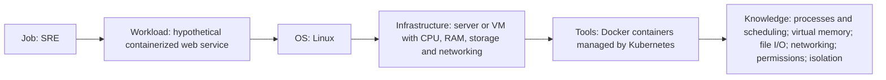

## Summary

Linux namespaces support containers, while cgroups organize processes and distribute resources; Docker's introductory container model shares a kernel (11-16 to 11-18). Kubernetes enforces CPU limits through throttling and memory limits through kernel OOM kills, and QEMU models a machine to run a guest OS (11-19 to 11-21). The proposed comparison and workload chain connect these mechanisms to virtualization and resource-management concepts, and are explicitly recorded as assumptions (11-22, 11-23).

## Key points

- Namespaces can implement containers; cgroups control resource distribution across a process hierarchy. (11-16, 11-17)
- Docker's introductory model describes containers sharing a kernel. (11-18)
- Kubernetes uses CPU throttling for CPU limits and kernel OOM kills for memory limits. (11-19, 11-20)
- QEMU system emulation models CPU, memory and devices to run a guest OS. (11-21)
- Recommended comparison: distinguish virtual-machine hardware and guest OS concepts from shared-kernel containers, and distinguish isolation from resource control. (11-22)
- Recommended report chain: connect an SRE role and hypothetical web-service workload to Linux, server resources, Docker/Kubernetes and OS knowledge. (11-23)

## Source comparison

The Linux references explain namespace use and cgroup resource distribution, while the Kubernetes reference explains CPU and memory limit enforcement at the workload level (11-16, 11-17, 11-19, 11-20). Docker supplies a shared-kernel container model and QEMU supplies a guest-machine model; comparing them is a proposed learning exercise (11-18, 11-21, 11-22). Most individual factual claims have one primary source; the two Kubernetes enforcement claims share a page. These sources do not establish the proposed configuration as Google's infrastructure.

## Proposed relationship visualization

This visualization represents assumption 11-23. It is a candidate example for later report creation; a human should review it before using it in the report.

## Proposed workload-to-concept mapping

All rows are applications of the recommended example in 11-23. The factual IDs identify the supporting mechanisms; the complete mapping remains an assumption.

| Example workload question | OS concepts | Supporting mechanism claims | Recommendation claims |
|---|---|---|---|
| Why is a service slow or restarting? | Processes, threads, scheduling and signals | 11-01, 11-02, 11-03, 11-05 | 11-06, 11-23 |
| How should memory observations be interpreted? | Virtual address spaces and per-thread memory | 11-02, 11-04 | 11-07, 11-23 |
| What does a completed write establish? | File I/O, page cache and durability | 11-08, 11-09, 11-10 | 11-14, 11-23 |
| Where should a failed connection or file-access operation be investigated? | Sockets, TCP and permissions | 11-11, 11-12, 11-13 | 11-15, 11-23 |
| What separates isolation, resource limits and a guest machine? | Namespaces, cgroups, containers and virtualization | 11-16 to 11-21 | 11-22, 11-23 |
